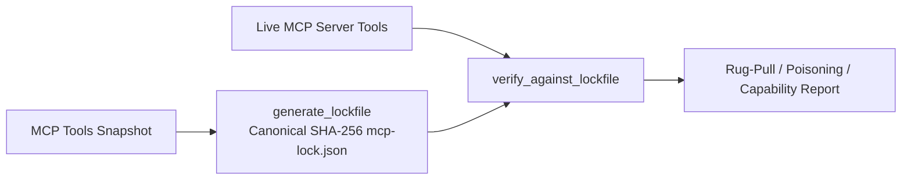

# mcp-lock

[](https://github.com/codesphere-u/mcp-lock/actions/workflows/ci.yml)
[](LICENSE)
[](pyproject.toml)
[](pyproject.toml)

**Cryptographic `mcp-lock.json` tool-schema pinning, anti-rug-pull drift verification, covert tool-description poisoning detection, and least-privilege capability auditor for MCP servers.**

- **Mission Domain:** Cybersecurity & AI Agent Supply-Chain Safety
- **Stack:** Pure Python 3.11+ (zero runtime third-party dependencies, `mypy --strict`, `ruff`, `pytest`)
- **Maintainer:** Codesphere Innovations (U) Limited (`codesphere-u`)

---

## Problem Solved

Third-party MCP servers can silently mutate tool descriptions post-install ('rug-pull tool poisoning') to inject covert `~/.ssh` or secret exfiltration instructions into coding agents.

## Key Features

- Canonical JSON SHA-256 tool-definition hashing pinning every server tool's name, description, `inputSchema`, and annotations into `mcp-lock.json`.
- Post-install drift verification catching rug-pull mutations (`MCP-LOCK-RUGPULL`), unpinned additions (`MCP-LOCK-ADDED`), and removals.
- Tool-description prompt-injection, sensitive-path (`~/.ssh`, `.env`), and zero-width Unicode steganography scanners plus capability surface policy enforcement.

## Architecture Overview



See [docs/architecture.md](docs/architecture.md) for module-level design details.

## Installation

```bash
git clone https://github.com/codesphere-u/mcp-lock.git
cd mcp-lock
uv sync --extra dev
```

Or install in editable mode with standard `pip`:

```bash
pip install -e ".[dev]"
```

## Quick Start (CLI)

```bash
mcp-lock demo
mcp-lock pin server_tools.json --out mcp-lock.json
mcp-lock verify mcp-lock.json live_tools.json
```

## Quick Start (Python API)

```python
from mcp_lock import generate_lockfile, verify_against_lockfile

tools = {"srv": [{"name": "ping", "description": "Health ping", "inputSchema": {}}]}
lock = generate_lockfile(tools)
assert verify_against_lockfile(lock, tools).passed
```

## Testing & Quality Gates

```bash
uv run ruff check src tests
uv run mypy src
uv run pytest -v
```

## Security, Contributing & Roadmap

- **Security:** See [SECURITY.md](SECURITY.md) for responsible disclosure procedures.
- **Contributing:** See [CONTRIBUTING.md](CONTRIBUTING.md) and [CODE_OF_CONDUCT.md](CODE_OF_CONDUCT.md).
- **Changelog & Roadmap:** See [CHANGELOG.md](CHANGELOG.md) and [ROADMAP.md](ROADMAP.md).

## License

MIT License — see [LICENSE](LICENSE).

## Support & Contact

Open an issue on [GitHub Issues](https://github.com/codesphere-u/mcp-lock/issues) or contact `codesphereinnovationz@gmail.com`.
